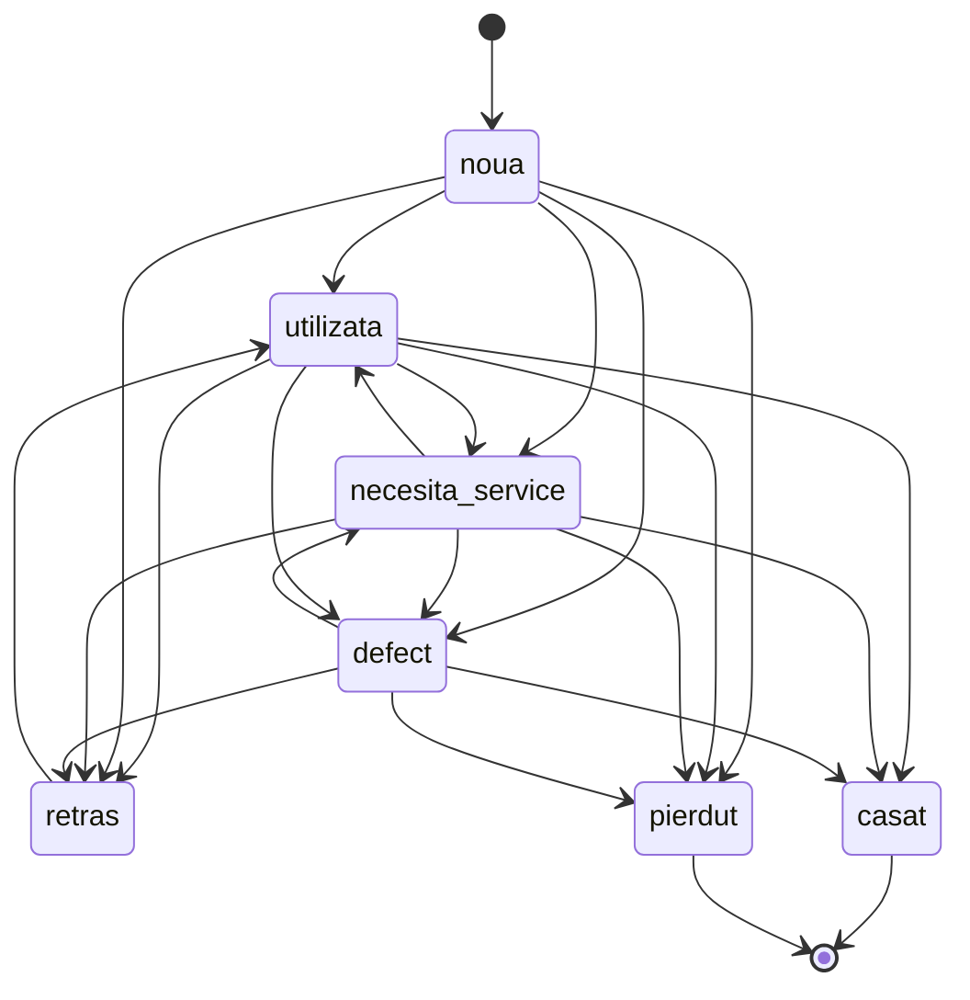

# Asset custody — a deterministic journey, not a flow of if-statements

**Constraint: this skill covers the most valuable assets only.** In scope: a **unealtă / utilaj**
(`tools` row — INV-12 extended it with `purchaseValueBani`, warranty, service interval), its
**custodie**, its **state**, its **two-sided transfers**, and its **QR label**. Out of scope, and the
reason to stop and use another skill: `materiale` (consumables — value travels with the material,
consumption is not a transfer), the `flota` vehicle graph, pontaj, cereri.

Why determinism is the point: a missing, double-moved or silently re-activated €40k excavator is the
failure this domain exists to prevent, and "it usually works" is how it happens. So the question for
every change is never "does the flow work" but **"given this state and this event, what is the next
state — and can the code answer differently?"** If it can, that is a defect.

## 1. The contract

Every step in the journey is one total function:

```
(state, event, context) -> { ok: true, next, effects } | { ok: false, reason }
```

1. **State and event are closed unions** as `const` tuples (`TOOL_STATES` style) — never `string`,
   never an enum, never a boolean pair standing in for a state.
2. **The next state comes from a table**, `as const satisfies Record<State, readonly State[]>`,
   or `Record<State, Partial<Record<Event, State>>>` once events carry meaning. Never from a
   branch scattered across a service. A new state that is missing from the table must be a
   `pnpm typecheck` failure.
3. **Pure.** No DB, no clock, no `process.env` inside the decision. Everything impure is read first,
   **in the same transaction**, and passed in as `context`. The client's snapshot of current state
   (`toolStateAtInitiation`) is a hint to display, never an input to a decision (it was Pitfall 2).
4. **No default arm.** A `switch` over a state ends in `assertNever`; a lookup of an unknown key
   throws. "Everything else" is how an illegal move becomes a legal one.
5. **Every write is checked.** An `UPDATE … RETURNING` that returns zero rows is a thrown error
   (`TransferAlreadyResolvedError`), never a quiet no-op — RLS filters rows, it does not complain.
6. **The database is the backstop, not the author.** The TS table is the enforcement point; the DB
   guard exists so a write path that forgets the check still cannot corrupt the record.
7. **History is temporal, not replayed.** Custody and transfers are append-only /
   closed-not-deleted. "Where was the unealtă on 12 June" is a `valid_from/valid_to` query.
   `audit_log` carries actor/old/new/**reason** for corrections, written by trigger.

## 2. The graphs that exist today (verify against the code — it wins over this file)

| Graph | Table | Owner file |
|---|---|---|
| **G1 tool state** `tools.stare` — 7 states | `ALLOWED_TRANSITIONS` | `server/services/inventar/tool-state-machine.ts` |
| **G2 transfer** `tool_transfers.status` — 5 states | `TRANSFER_TRANSITIONS` | `server/services/inventar/transfer-state-machine.ts` |
| **G3 custody** — one depozit XOR one șantier, never a person | the composition of G1 × G2 | `accept-/force-complete-/initiate-transfer.ts` |
| **G4 QR** — a label resolves to the ordinary tool URL | `toolScanUrl` | `server/inventar/tool-qr.ts` |



Facts read off G1 (recompute them; do not trust this list after a change):
- **Source:** `noua` has no incoming edge — a unealtă can never become "new" again.
- **Sinks:** `casat`, `pierdut` — empty target lists; `casat`/`pierdut` are the *only* terminals.
- **One cycle family:** `utilizata ⇄ necesita_service ⇄ defect`, plus `utilizata ⇄ retras`. That strongly
  connected set is where a tool legitimately loops. `retras`'s ONLY outgoing edge is `→ utilizata`, so
  it reaches `casat`/`pierdut` only by going back through `utilizata`; `defect` cannot reach
  `utilizata` directly (only via `necesita_service`). Any edit must keep "every non-terminal can
  reach a terminal".
- **`retras → utilizata` is reachable only through the standalone edit.** The transfer path closes it
  in `assertValidConfirmedState` (`RetrasConfirmedStateError`). The table alone permits it.
- **`casat`/`pierdut` are never set by a transfer** (`TerminalStateViaTransferError`): that path skips
  `assertCanCasare` and the `casare_records` row.

G2 is a star: `pending → {accepted, rejected, cancelled, force_completed}`, all four terminal.
**A transfer is never re-resolved.** `one_pending_per_tool` (partial unique index) makes the
"at most one open transfer per unealtă" invariant a database fact.

DB backstops to keep in sync with the TS tables: `tools_terminal_state_guard` (BEFORE UPDATE),
the `tool_transfers` transition guard (`drizzle/0138`), custody XOR (`drizzle/0034`),
`tool_transfers_update_scoped` RLS, the tool audit trigger. A graph change without a matching
backstop decision is incomplete — say in the ticket whether the DB is changed or deliberately not.

## 3. Loops are graphs

A "retry", a "re-scan", a "service loop", a "send back to depozit" is **an edge or a cycle in a graph**,
not a `while`, not a `useEffect`, not a polling timer that mutates state. Rules:

1. **Draw it before you code it.** The ticket gets a mermaid `stateDiagram-v2` (or an event table)
   with every state and every event named. If you cannot draw it, you cannot test it.
2. **Name every cycle and its exit.** A cycle with no edge to a terminal is a trap: the asset can
   circulate forever and nobody owes anybody an answer.
3. **Check four properties on every graph change** (recompute from the exported table — a test, not
   an eyeball):
   - every state is reachable from the initial state (no orphan);
   - every non-terminal state can reach a terminal (no dead loop);
   - terminal ⇔ empty target list (no "terminal" with an exit, no non-terminal sink);
   - the TS tuple equals the DB enum (`pgEnum`), value for value.
4. **Composed graphs multiply.** G3 is G1 × G2: enumerate the *product* (tool state × pending/not ×
   custody kind) for the event you are adding and decide each cell. "It can't happen" is a cell
   that needs a guard or a test saying so.
5. **A QR scan is a read.** It is an identifier, never a capability (LS-0279): no token, no signed
   link. Scanning must not change state. The only designed write is *scan-to-claim*, which is **the
   destination accepting** — one audited transaction that writes and resolves the `tool_transfers`
   row, marked as a scan-claim, destination limited to a șantier the claimer manages. It is not
   built; if you build it, it is a new **event on G2/G3** with its own row in the event table, not a
   side door around them.

## 4. Event table — the artifact to produce for any new behaviour

| Event | Actor (capability) | From (state·custody·transfer) | Next | Effects | Audit reason | Illegal-case error |
|---|---|---|---|---|---|---|

Rules for the table: one row per (event, from) pair; the *Next* cell is a single value, never
"depends"; if it depends, the difference is a context field and it becomes two rows. `Effects` lists
every write (tools row, transfer row, casare record, notification, history row). Illegal cases name
the typed error class that is thrown.

## 5. Prove the next state — independently

A test that computes the expected state with the same table it tests proves nothing.

- **Oracle first.** Write the expected `next` as a literal table in the test, from the *requirement*
  (RBAC matrix, QA answer, ticket), then call the code and compare. Use the exhaustive
  cartesian-product style already in `transfer-state-machine.test.ts` (5×5) and
  `tool-state-machine.test.ts` (7×7) — every pair asserted legal or throwing.
- **Property tests over the graph** (section 3.3) live next to the table.
- **Race test** for any write that resolves a pending thing (`transfer-resolve-race.test.ts` is the
  pattern): two resolvers, one winner, the loser throws and the tool did not move.
- **DB-level test** for each backstop, against the test stack — `pnpm test <paths>` only (a bare
  `pnpm vitest run` hits the prod-clone `.env.local`). RLS suites are not in `pnpm test:authz`.
- The UI reads legal next moves from a helper over the table; it never restates the list.

## 6. Procedure for a change

1. Read the table and the diagram; read the service that resolves the event. Code wins over this file.
2. Write the event table row(s) and the graph delta in the ticket. (`p4t-ticket-invariant`; this is
   high-risk tier when it touches `server/db/schema/`, `server/authz/` or the RBAC matrix.)
3. Edit the table first; let `pnpm typecheck` show every site that must now answer.
4. Add the guard/error class; keep the guard order (the `retras` guard runs before the generic one).
5. Service order, as `accept-transfer.ts`: assert transition → authorize against the row's own
   endpoint → re-read current state in the same tx → domain guards → set `app.audit_reason` →
   resolve row (`.returning()` checked) → move the tool (`.returning()` checked).
6. DB backstop decision + migration if needed (`drizzle-kit generate && migrate`, never `push`;
   a new policy needs its grant migration).
7. Tests per section 5. Then the full gate: `pnpm typecheck && pnpm test && pnpm lint:all` **and every
   `gate:*` enumerated from `package.json`** — read the output bare, never through `| tail`.
8. Look at the real screen on localhost:3000 before saying done.

## 7. Slop checklist — any one of these is a finding

- A state or event typed as `string`, or a status held in two booleans.
- Next state computed in a component, a hook, or an `actions.ts`.
- `default:` / `else` swallowing an unknown state.
- A decision that reads the client's copy of the current state.
- An `UPDATE` whose row count is not checked.
- `purchaseValueBani` treated as `0` for "unknown" (null means unknown), or arithmetic on it outside
  `cost-engine/` and `src/lib/money.ts` (integer bani, ADR-011; `gate:money`).
- A person recorded as a custodian (INV-06), or custody that is neither/both of depozit, șantier.
- A QR payload with anything but the ordinary tool URL; a scan route that mutates.
- A "high value" cutoff written as a literal. It is configuration (see open items).
- A cycle with no named exit; a terminal state with an outgoing edge.
- A test that imports the table it is checking to derive its expectation.
- A figure on screen that differs from the export (calculation parity — `cost-engine/` owns it).

## 8. Open, deliberately unresolved — do not invent an answer

- **What counts as "high value".** `tools.purchase_value_bani` exists and is nullable, but no code
  outside the schema reads it and there is no threshold. A cutoff must be configuration with a
  `.planning/PROJECT.md` Key Decisions entry, and the client has to name it.
- **Scan-to-claim** is specified (section 3.5), not built; it needs a transfer family in `ALERT_TYPES`.
- **Șef Flotă "DOAR AUTO"** inventory visibility is still unconfirmed in `RBAC-MATRIX.md`.
