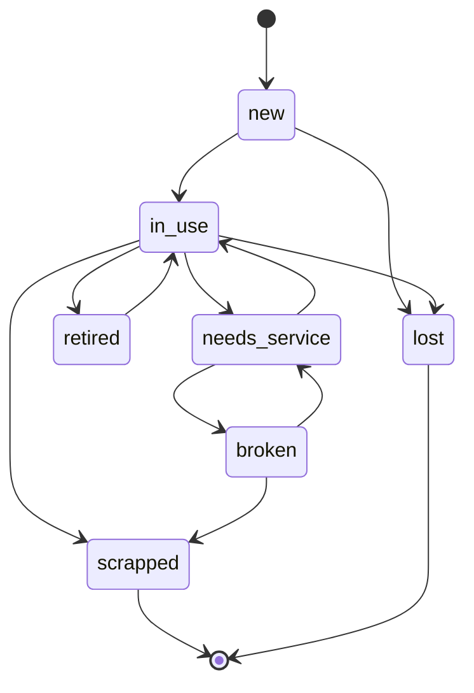

# State machines — a deterministic journey, not a flow of if-statements

**Scope:** entities whose lifecycle carries value or accountability — an expensive asset and who
holds it, an order, a two-sided transfer, an approval, a payment. Out of scope: consumables whose
value travels with quantity (consumption is not a transfer), and plain CRUD with no lifecycle.

Why determinism is the point: a missing, double-moved or silently re-activated high-value item is
the failure these domains exist to prevent, and "it usually works" is how it happens. So the question
for every change is never "does the flow work" but **"given this state and this event, what is the
next state — and can the code answer differently?"** If it can, that is a defect.

Two modes: **design** (before code — produce the event table and the graph delta) and **audit**
(after code — verify the diff against sections 1–7).

## 1. The contract

Every step in the journey is one total function:

```
(state, event, context) -> { ok: true, next, effects } | { ok: false, reason }
```

1. **State and event are closed unions** as `const` tuples (`ORDER_STATES` style) — never `string`,
   never an enum, never a boolean pair standing in for a state.
2. **The next state comes from a table**, `as const satisfies Record<State, readonly State[]>`, or
   `Record<State, Partial<Record<Event, State>>>` once events carry meaning. Never from a branch
   scattered across a service. A new state missing from the table must be a typecheck failure.
3. **Pure.** No DB, no clock, no `process.env` inside the decision. Everything impure is read first,
   **in the same transaction**, and passed in as `context`. The client's snapshot of current state is
   a hint to display, never an input to a decision.
4. **No default arm.** A `switch` over a state ends in `assertNever`; a lookup of an unknown key
   throws. "Everything else" is how an illegal move becomes a legal one.
5. **Every write is checked.** An `UPDATE … RETURNING` that returns zero rows is a thrown typed error
   (`TransferAlreadyResolvedError`), never a quiet no-op — row-level security filters rows, it does
   not complain.
6. **The database is the backstop, not the author.** The TS table is the enforcement point; a DB
   guard (trigger, check, partial unique index) exists so a write path that forgets the check still
   cannot corrupt the record.
7. **History is temporal, not replayed.** Custody and transfers are append-only / closed-not-deleted.
   "Where was the item on 12 June" is a `valid_from/valid_to` query. An audit log carries
   actor/old/new/**reason** for corrections, written by trigger.

## 2. Graph registry — build it from the host codebase

Before any change, list every machine in the domain. Code wins over any doc, including this one.

| Graph | Column / field | Transition table | Owner file | DB backstops |
|---|---|---|---|---|

Find them by searching for `*_STATES`, `TRANSITIONS`, `stare`/`status`/`state` columns, `pgEnum`s
and `assertNever`. Note composed graphs (custody = item state × transfer state) as their own row.

### Worked example (neutral) — equipment lifecycle



Facts read off it (recompute after any change — never trust a list):
- **Source:** `new` has no incoming edge — an item never becomes new again.
- **Sinks:** `scrapped`, `lost` — the only terminals, both with empty target lists.
- **Cycle family:** `in_use ⇄ needs_service ⇄ broken`, plus `in_use ⇄ retired`. `retired`'s only
  exit is back through `in_use`; that is its named exit to a terminal.
- **Path-specific edges:** if a transfer must never set a terminal state (scrapping has its own
  guards and record), the table alone permits it — the transfer path needs an explicit guard error.

A companion transfer graph is typically a star: `pending → {accepted, rejected, cancelled,
force_completed}`, all terminal. **A transfer is never re-resolved**; "at most one open transfer per
item" is a partial unique index, i.e. a database fact.

Keep DB backstops in sync with the TS tables (terminal-state trigger, transition guard, custody XOR
check, scoped update policy, audit trigger). A graph change without a backstop decision is
incomplete — record whether the DB changes or deliberately does not.

## 3. Loops are graphs

A "retry", a "re-scan", a "service loop", a "send back" is **an edge or a cycle in a graph**, not a
`while`, not a `useEffect`, not a polling timer that mutates state.

1. **Draw it before you code it.** The ticket gets a mermaid `stateDiagram-v2` (or an event table)
   naming every state and event. If you cannot draw it, you cannot test it.
2. **Name every cycle and its exit.** A cycle with no edge to a terminal is a trap: the item can
   circulate forever and nobody owes anybody an answer.
3. **Check four properties on every graph change** (computed from the exported table in a test, not
   eyeballed):
   - every state is reachable from the initial state (no orphan);
   - every non-terminal can reach a terminal (no dead loop);
   - terminal ⇔ empty target list;
   - the TS tuple equals the DB enum, value for value.
4. **Composed graphs multiply.** Enumerate the *product* (item state × transfer open/not × custody
   kind) for the event you add and decide each cell. "It can't happen" is a cell that needs a guard
   or a test saying so.
5. **A scan is a read.** A QR/barcode is an identifier, never a capability: no token, no signed link,
   scanning changes nothing. A designed write such as *scan-to-claim* is a new **event** with its own
   event-table row and audit reason, not a side door around the graph.

## 4. Event table — the artifact for any new behaviour

| Event | Actor (capability) | From (state·custody·transfer) | Next | Effects | Audit reason | Illegal-case error |
|---|---|---|---|---|---|---|

One row per (event, from) pair; *Next* is a single value, never "depends" — if it depends, the
difference is a context field and it becomes two rows. *Effects* lists every write (entity row,
transfer row, disposal record, notification, history row). Illegal cases name the typed error thrown.

## 5. Prove the next state — independently

A test that computes the expected state with the same table it tests proves nothing.

- **Oracle first.** Write expected `next` as a literal table in the test, from the *requirement*
  (permission matrix, ticket, stakeholder answer), then call the code and compare. Exhaustive
  cartesian product: every (from, to) pair asserted legal or throwing.
- **Property tests over the graph** (§3.3) live next to the table.
- **Race test** for any write that resolves a pending thing: two resolvers, one winner, the loser
  throws and the item did not move.
- **DB-level test** for each backstop, against a test database — never a production clone.
- The UI reads legal next moves from a helper over the table; it never restates the list.

## 6. Procedure for a change

1. Read the table, the diagram and the service that resolves the event.
2. Write the event-table rows and the graph delta in the ticket (high-risk tier if it touches schema,
   authorization or the permission matrix — see `ticket-traceability`).
3. Edit the table first; let the project's typecheck command show every site that must now answer.
4. Add the guard and typed error; keep guard order (specific guards before the generic one).
5. Service order: assert transition → authorize against the row's own endpoint → re-read current
   state in the same tx → domain guards → set the audit reason → resolve row (returning checked) →
   move the entity (returning checked).
6. DB backstop decision + a generated migration if needed (never an unreviewed schema push; a new
   policy needs its grants).
7. Tests per §5, then the project's full gate (typecheck, tests, lint, every custom gate) — read the
   output whole, never through `| tail`.
8. Look at the real screen before saying done.

## 7. Slop checklist — any one of these is a finding

- A state or event typed as `string`, or a status held in two booleans.
- Next state computed in a component, a hook, or a thin action file.
- `default:` / `else` swallowing an unknown state.
- A decision that reads the client's copy of the current state.
- An `UPDATE` whose row count is not checked.
- A monetary value treated as `0` for "unknown" (null means unknown), or money arithmetic outside the
  project's money/cost module (integer minor units).
- Custody held by an unintended kind of holder, or custody that is neither/both of the allowed kinds.
- A scan payload carrying anything but an identifier; a scan route that mutates.
- A business threshold ("high value") written as a literal — it is configuration and a recorded
  decision.
- A cycle with no named exit; a terminal state with an outgoing edge.
- A test that imports the table it checks to derive its expectation.
- A figure on screen that differs from the export of the same figure.

## 8. Open questions — do not invent an answer

List in the ticket every rule the code and the stakeholders have not settled (thresholds, unbuilt
events, unconfirmed permissions). Leave them open and name who decides; never fill them by guess.
