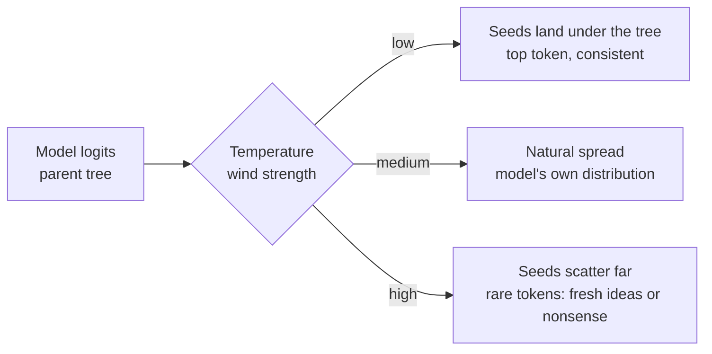
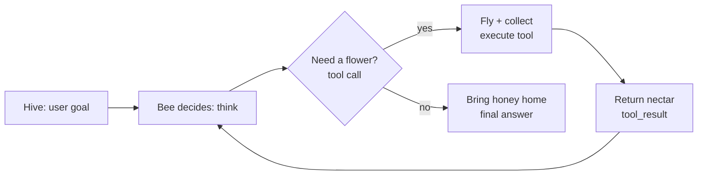

# MindForge: learn by playing, remember through nature

> **Status:** Draft v2 for discussion · **Owner:** Sorin Vieriu · **Last updated:** 2026-11-02
> **First milestone:** CCDV-F exam on **2026-12-07** (5 weeks from today)
>
> We work in SDLC order: **Plan → Design → Build → Test → Maintain**. Nothing gets built before
> its phase here is agreed. To contribute, open a PR against this file. Open questions are marked **❓Q-n**.
>
> **Changes in v2:** MindForge is now a general learning platform built from *learning packs*. CCDV-F is the
> first pack, not the whole product. The game layer and nature associations are now core features, and diagrams are a first-class content type.

---

## 0. TL;DR

MindForge turns any structured curriculum into a **living forest you grow by remembering**.

- **Learning packs.** A pack is any curriculum: an exam, a course, an internal onboarding. Each pack becomes a **biome** in your forest. The first pack is *Claude Certified Developer – Foundations*.
- **Every skill is a tree.** It grows when you recall it correctly and wilts when the spaced-repetition model predicts you're about to forget it. The forest shows your **real memory state**, not points you've collected.
- **Nature associations.** Every concept gets an analogy from nature, and every analogy says **where it stops being accurate**. Example: *prompt injection is a cuckoo laying its egg in another bird's nest*.
- **Diagrams everywhere.** Every concept has a diagram, and several games ask you to *build or fix* one.
- **Games, not quizzes.** Scenario duels, "spot the cuckoo", diagram builder, boss storms, and co-op group expeditions.
- **Together.** Study groups share a forest, review AI-generated content, and take on expeditions as a team.

**North star:** after each session you can explain something tomorrow without notes, and the forest shows whether that's true.

---

## 1. PLAN

### 1.1 Problem

- Course material (videos, docs, slides) is consumed passively. You get a false sense of understanding, and most of it is forgotten within a week.
- Certification exams test **judgment between options that look alike**, not definitions.
- Typical gamification (points, badges) rewards activity, not memory. You can "level up" while forgetting everything.
- People study alone and can't see where the group as a whole is weak.

### 1.2 Product principles

1. **Game state = memory state.** Every visible reward comes from measured recall (FSRS retrievability, correct answers, Feynman scores). Time spent or pages read earns nothing.
2. **Associate before you memorise.** New concepts are hooked to something familiar: nature by default, and the learner's own world later.
3. **Accuracy over entertainment.** Analogies are labelled as analogies, state where they break, and cite the source material. A fun but wrong explanation is a bug.
4. **Pack-agnostic engine.** The engine never hard-codes a curriculum. CCDV-F is data.
5. **Learn together.** Groups are built in from the start, not added later.

### 1.3 First pack: CCDV-F (from the official Exam Guide v1.0, July 2026)

| Item | Value |
|---|---|
| Questions | 53, multiple-choice + multiple-response ("select N") |
| Time | 120 min |
| Pass | Scaled 720 / 1000, report broken down by domain |
| Validity | 12 months |

| # | Domain (= biome) | Weight | Skills (= trees, weight %) |
|---|---|---|---|
| 1 | Agents & Workflows | 14.7 | Agent Architecture 4.5 · Agent Construction 5.3 · Agent Patterns & Frameworks 4.9 |
| 2 | Applications & Integration | **33.1** | Understanding Requirements 3.4 · Systems Life Cycle 2.8 · Claude API Mechanics 6.8 · SWE Foundations 7.4 · Claude App Design 8.6 · Configuration Mgmt 4.1 |
| 3 | Claude Code | 3.1 | Claude Code Operation 3.1 |
| 4 | Eval, Testing & Debugging | 2.6 | Debugging & Error Handling 2.6 |
| 5 | Model Selection & Optimization | 16.8 | LLM Fundamentals 5.2 · Technical Fundamentals 6.1 · Model Selection 2.7 · Cost & Tokens 2.8 |
| 6 | Prompt & Context Engineering | 11.0 | Context Eng 3.8 · Prompt Eng 4.6 · Output Handling 2.6 |
| 7 | Security & Safety | 8.1 | AI App Security 3.2 · Guardrails 2.3 · Claude Hooks 1.0 · Identity/Secrets 1.6 |
| 8 | Tools & MCPs | 10.6 | Tool Implementation 4.4 · MCP Server Dev 2.1 · Agentic Customization 4.1 |

**Sources:** Skilljar paths *Claude Developer* (9 courses) and *CCDV-F Prep* (5 courses, ~13 h), plus public docs at docs.claude.com.
⚠️ Skilljar content is behind a login. **We never scrape it.** Learners paste in their *own notes*.

**Candidate next packs (after Dec 7, ❓Q-7):** other Anthropic certifications, internal company onboarding, any course a group chooses.

### 1.4 Goals and success criteria

| ID | Goal | Measure |
|---|---|---|
| G1 | Everyone in the first cohort passes CCDV-F on 2026-12-07 | Exam results (shared voluntarily) |
| G2 | Each member's forest is ≥ 80% "healthy" (FSRS retrievability ≥ 0.85) 5 days before the exam | App |
| G3 | All 27 skills have a nature card, a diagram, and ≥ 15 approved questions | Coverage dashboard |
| G4 | Content is correct | Each item needs ≥ 2 human approvals; 0 open "flagged as wrong" items in exam week |
| G5 | People come back because they want to | ≥ 5 sessions/week per member, without notification spam |
| G6 | The engine is truly pack-agnostic | A second, small pack (e.g. a 5-skill internal topic) loads **with zero code changes** before Dec 7 |

### 1.5 Non-goals (until after Dec 7)

- Generic AI import of any PDF or URL into a full pack. In v1, packs are written as files and reviewed.
- Voice, mobile app, AI-generated illustrated images or comics
- Competitive leaderboards that shame people. Group progress is co-op first.
- Reproducing Skilljar content

### 1.6 Roles

| Role | Can |
|---|---|
| **Learner** | Play, grow their forest, run Feynman mode, see their own readiness |
| **Group admin** | Create a group for a pack, invite people, start expeditions, see the group heatmap |
| **Reviewer** (any learner) | Approve, reject or flag cards, questions and diagrams. Reviewing counts as play (it waters the tree). |
| **Pack author** | Create or edit a pack: blueprint, sources, seed content |

### 1.7 Timeline (fixed date)

| Week | Dates | Phase | Outcome |
|---|---|---|---|
| W1 | Nov 2–8 | Plan + Design + start Build | Doc agreed, pack format and data model frozen, CCDV-F pack seeded, content generation running |
| W2 | Nov 9–15 | Build + Test | **Playable MVP:** forest, Daily Walk, Scenario Duel, nature cards with diagrams, groups |
| W3 | Nov 16–22 | Maintain + small features | Spot the Cuckoo, Diagram Builder, Feynman, review sprint |
| W4 | Nov 23–29 | Maintain | Boss Storms (domain mock exams), group Expedition, Full Storm (53 questions / 120 min) |
| W5 | Nov 30–Dec 6 | **Freeze** | No new features. Play only |

**Rule:** if a feature isn't playable by its week, it moves to after Dec 7. The game exists to help us pass, not to replace studying.

### 1.8 Risks

| Risk | Mitigation |
|---|---|
| AI produces wrong facts about Claude (it changes fast) | Ground in fetched official docs, require citations, a verifier pass, 2 human approvals, a flag button |
| Nature analogy is memorable but misleading | Required "where it breaks" field; reviewers check the analogy, not just the facts |
| Game layer eats build time | MVP forest is a simple SVG grid; animations come later |
| Gamification rewards activity instead of memory | Principle 1: all rewards come from measured recall |
| Building the app eats study time | Hard weekly cuts. Building it on Claude also covers exam domains (§2.9) |
| Claude API cost | Batch API for bulk generation, prompt caching on docs, Haiku for grading |

---

## 2. DESIGN

### 2.1 Concept hierarchy (pack-agnostic)

```
Pack (curriculum)        → Biome         e.g. "CCDV-F", "Company onboarding"
  └─ Domain              → Region        e.g. "Tools & MCPs" (weight 10.6%)
       └─ Skill          → Tree          e.g. "MCP Server Development"
            └─ Concept   → Branch/leaf   e.g. "stdio vs socket transport"
                 └─ Items: nature card · diagram · contrast table · questions · Feynman prompts
```

A **pack** is a folder of files (`packs/<slug>/pack.yaml` + seed content). It is validated by a schema and loaded without code changes.

### 2.2 The Knowledge Forest (core game model)

| Memory signal (measured) | Forest representation |
|---|---|
| Skill never studied | 🌰 Seed |
| First successful recall | 🌱 Sprout |
| FSRS stability ≥ 3 days | 🌿 Sapling |
| Stability ≥ 14 days + Feynman passed | 🌳 Tree |
| Stability ≥ 45 days + Boss Storm survived | 🌲 Ancient tree |
| Retrievability dropping below 0.85 (review due) | 🍂 Wilting leaves, *"this tree needs water"* |
| Overdue for a long time | 🥀 Drooping, but it never dies. Coming back is always rewarded |
| Domain readiness | Region health / weather |
| Group | Shared forest: everyone's trees on one map, the group's weak regions shown as a heatmap |

- **Watering = reviewing.** The Daily Walk visits the wilting trees first, prioritised by *blueprint weight × weakness × due date*.
- **Streaks** are seasons. Missing a day doesn't reset anything. The forest just shows what needs care. No guilt mechanics.
- **Readiness score** (for exam packs): estimated scaled score per region, shown as the forest's "weather".

### 2.3 Game modes

| Mode | What you do | Trains | MVP? |
|---|---|---|---|
| **Daily Walk** | 10–15 min guided session through due trees: recall → card → question | Spaced retrieval | ✅ W2 |
| **Scenario Duel** | Exam-style "which approach fits best?" Pick, then see the rationale for *every* option | Telling similar options apart | ✅ W2 |
| **Seed Planting** | First encounter with a skill: nature card → diagram → 3 quick checks | Encoding + association | ✅ W2 |
| **Spot the Cuckoo** | Find the injected instruction, the wrong claim, or the bad config in a snippet | Security, debugging, critical reading | W3 |
| **Diagram Builder** | Drag nodes and arrows to rebuild a process (e.g. the agent tool-use loop), or find the wrong arrow | Mental models | W3 |
| **Feynman Campfire** | Explain the concept to a 12-year-old without using banned words; Claude finds the gaps | Deep understanding | W3 |
| **Odd One Out** | 4 items, one doesn't belong; explain why | Classification, contrast | W3 |
| **Boss Storm** | Timed domain challenge mixing recall, scenarios and connections between skills. You only survive if you show understanding | Integration | W4 |
| **Full Storm** | Full mock exam (53 questions / 120 min, blueprint-weighted) | Exam conditions | W4 |
| **Group Expedition** | Weekly co-op goal: "Together, bring the Security region to green." Everyone's correct recalls count | Social motivation | W4 |
| **Pollination** | Reviewing someone else's AI-generated item (approve, fix or flag) | Peer review = learning | ✅ W2 |

### 2.4 Nature association engine

Every concept gets a **nature card**:

1. **Simply:** one or two plain sentences
2. **In nature:** the analogy
3. **Where it breaks:** required; where the analogy stops being accurate
4. **Diagram:** see §2.5
5. **Contrast:** when to use X instead of Y
6. **Sources:** official doc links

**Seed nature library for CCDV-F** (to be reviewed, ❓Q-8):

| Concept | Nature analogy | Where it breaks |
|---|---|---|
| Prompt injection | **Cuckoo** lays its egg in another bird's nest; the host raises it as its own | Hosts sometimes detect cuckoo eggs by appearance. Injected text can look identical to legitimate data, so defences must be structural (isolation, least privilege) |
| MCP server | **Mycorrhizal fungal network** connecting many trees and moving resources between them | The fungus trades on its own; an MCP server only acts when a client calls it |
| Prompt caching | **Squirrel caching nuts**: prepare once, retrieve cheaply later | A cache entry expires after a time to live (TTL); it can only be reused if the prefix is *exactly* the same |
| Batch API vs realtime | **Bees storing honey for winter** vs a hummingbird feeding right now | Batch results may come back in any order and are matched by `custom_id` |
| Context window | **A pond's carrying capacity**: it can only support so much life | Not a gradual decline: hitting the limit fails or truncates |
| Compaction | **Composting**: old material broken down into dense nutrients | Information is lost; choose carefully what to keep |
| Subagents | **Ant colony foragers**: each explores alone and brings back only the food, not the whole trail | Ants share pheromone trails; subagents share nothing unless it's passed in or returned |
| Hooks | **Venus flytrap trigger hairs**: a deterministic reflex, no "thinking" | Hooks can block, modify or log; a flytrap only closes |
| Opus / Sonnet / Haiku | **Elephant / wolf / hummingbird**: depth and memory vs balance vs speed and low cost | Model capabilities change with each release; check the current docs |
| Agent tool-use loop | **Bee foraging**: sense → fly → collect → return → decide again | A bee doesn't decide when the task is "done"; the agent's stop condition is designed by us |
| Tool descriptions | **Waggle dance**: precise instructions so others can find the resource | A bad dance wastes one trip; a bad tool description gets the wrong tool picked over and over |
| Streaming | **A river** delivering water continuously vs a lake you collect from once | |
| Least privilege | **Cell membrane**: only lets through what the cell needs | |
| Evals | **Field ecologist sampling plots**: measure systematically, don't judge by one walk | |
| Temperature (sampling) | **Seed dispersal on a windy day**: in calm air almost every seed lands under the parent tree (the most likely token); in strong wind seeds scatter far, a few onto fertile new ground (creativity), many onto rock (nonsense) | Wind pushes seeds in a *direction*; temperature never changes which token is most likely, only how strongly it dominates. Calm air still spreads seeds a little, but T=0 is (near-)greedy. T=0 does not guarantee identical outputs |

**Example full card: Temperature** (skill: LLM Fundamentals, proposed for review):

| Field | Content |
|---|---|
| **Simply** | Temperature controls how adventurous the model is when picking the next token. Low: it almost always takes the top choice. High: less likely choices get picked more often. The model's knowledge (its logits) is unchanged; only the sampling is reshaped. |
| **In nature** | Seeds in the wind. Calm air drops them under the tree; strong wind scatters them, sometimes onto fertile ground, often onto rock. Temperature is the wind. |
| **Where it breaks** | (1) Wind has a direction; temperature only flattens or sharpens the distribution and keeps the ranking. (2) T=0 picks the top token every time, while calm air still spreads seeds a little. (3) T=0 is not a guarantee of identical outputs across calls. (4) "Less likely" is not "wrong": for extraction it usually is, for brainstorming it is often the useful choice. |
| **Why "temperature"?** | It is the same formula physics uses for molecules (Boltzmann distribution): P(state) ∝ e^(−E/kT) vs P(token) ∝ e^(logit/T). Heat lets particles reach higher-energy states; heat lets the model reach lower-probability tokens. |
| **Diagram** | One bar chart at three temperatures, next to seeds landing near or far from the tree (see below). |
| **Contrast** | Temperature *reshapes* the whole distribution; top-p / top-k *cut off* the tail. Low temperature for classification and extraction, higher for ideation. |
| **Sources** | Claude API docs, `temperature` parameter (range and default to be verified against current docs before approval) |

Worked numbers for the diagram (logits `[2, 1, 0]`, softmax of `logit / T`):

| Temperature | Token A | Token B | Token C | Seeds |
|---|---|---|---|---|
| 0.5 (calm) | 87% | 12% | 2% | almost all under the tree |
| 1.0 (as trained) | 67% | 24% | 9% | a natural spread |
| 2.0 (storm) | 51% | 31% | 19% | scattered far |



**Game hooks:** *Diagram Builder*: "set the wind to the temperature that produced this distribution". *Scenario Duel*: "A JSON extraction pipeline returns inconsistent fields between runs. What do you change first?"

Later (Phase 2): a **personal analogy profile** (hobbies, profession, own projects) as extra themes. Nature stays the default because it's universal and visual.

### 2.5 Diagrams

- **Format:** Mermaid (flowchart, sequence, state, mindmap) stored as text. It's deterministic, reviewable in PRs, diffable, and renders client-side.
- **Diagram types:** process flow (agent loop, batch lifecycle), sequence (client ↔ MCP server ↔ tool), decision tree (which model / which tool type), concept map (how skills in a region connect), nature-vs-tech side-by-side (e.g. cuckoo ↔ injection).
- **Interactive:** the same diagram source powers *Diagram Builder*. Nodes get shuffled and the learner rebuilds them, or one edge is corrupted for "spot the wrong arrow".
- **Later:** illustrated nature scenes (AI images) once accuracy review covers images too.

Example (agent loop as bee foraging):



### 2.6 Learning loop

```
Daily Walk picks a tree (weight × weakness × due)
  → New?    Seed Planting (nature card + diagram + quick checks)
  → Known?  Recall first (no hints) → Scenario Duel / Spot the Cuckoo / Diagram Builder
  → Shaky?  Feynman Campfire
  → FSRS updates stability/retrievability → tree grows or wilts
  → Group forest + readiness weather update
```

### 2.7 Data model (draft)

```
packs(id, slug, name, kind[exam|course|onboarding], version, exam_meta_json?)
domains(id, pack_id, code, name, weight, biome_theme)
skills(id, domain_id, code, name, weight, description)
concepts(id, skill_id, name, summary)
concept_links(from_concept_id, to_concept_id, relation)        -- knowledge graph, cross-pack allowed
sources(id, pack_id, skill_id?, kind[doc|course|note], url, title, owner_id?)
items(id, concept_id|skill_id, type[nature_card|contrast|diagram|question|feynman_prompt|cuckoo],
      body_json, citations[], status[draft|approved|flagged|rejected],
      prompt_version, model, version, created_by, group_id?)
item_reviews(id, item_id, reviewer_id, verdict, comment)
groups(id, name, pack_id, target_date?, invite_code)
group_members(group_id, user_id, role)
memory_states(user_id, skill_id|item_id, fsrs_json, stability, retrievability, due_at)  -- drives tree state
attempts(id, user_id, item_id, mode, answer_json, correct, score, ms, created_at)
storms(id, user_id|group_id, kind[boss|full], pack_id, domain_id?, result_json)
expeditions(id, group_id, goal_json, starts_at, ends_at, progress_json)
```

Items are scoped **global** (pack-level, approved) or **group** (drafts and group-specific). Row-level security is based on group membership.

### 2.8 Architecture (❓Q-1: Supabase vs Drizzle+Turso; proposal: Supabase for auth + RLS)

```
Next.js 16 (App Router, RSC) + Tailwind + shadcn/ui + Mermaid + SVG forest
   │
   ├── Learning engine (pure TS, no UI, no pack hard-coding)
   │     ├─ scheduler (ts-fsrs) → memory_states
   │     ├─ forest model (memory → tree stage)
   │     ├─ selector (weight × weakness × due)
   │     └─ readiness model (exam packs)
   │
   ├── Game modes (each = engine + item types + UI)
   │
   ├── AI services (Claude API, small typed prompts, structured outputs)
   │     ├─ NatureCardWriter    Sonnet   grounded on cached docs; must fill "where it breaks"
   │     ├─ DiagramWriter       Sonnet   outputs Mermaid + node list for Diagram Builder
   │     ├─ QuestionWriter      Sonnet   via Batch API for bulk runs
   │     ├─ CuckooWriter        Sonnet   plants one realistic flaw + its explanation
   │     ├─ Verifier            Opus     checks answer keys, citations, analogy limits, Mermaid validity
   │     ├─ FeynmanGrader       Haiku/Sonnet
   │     └─ NotesMapper         Haiku    maps pasted notes to skills (untrusted input)
   │
   └── Supabase (Postgres + Auth + RLS)
```

Principles: every generated item carries citations and the prompt version. Untrusted input (notes, fetched pages) is kept separate from instructions. The engine and AI services know nothing about any specific pack.

### 2.9 Building it = studying CCDV-F

| We build | Exam skill exercised |
|---|---|
| Structured-output writers + validators | Output Handling, API Mechanics |
| Prompt caching on the docs corpus | Cost & Token Management |
| Batch generation overnight | API Mechanics (batch vs realtime) |
| Writer → Verifier pipeline | Agent Architecture, Patterns |
| Golden set + evals | Eval, Testing & Debugging |
| Untrusted notes, Spot the Cuckoo | AI Application Security |
| CLAUDE.md, hooks, skills in this repo | Claude Code, Hooks, Config Mgmt |
| Optional MCP server exposing packs | MCP Server Development |

### 2.10 Open questions

- **❓Q-1** Supabase or Drizzle+Turso? *Proposal: Supabase.*
- **❓Q-2** Who pays for the Claude API, and what's the monthly cap?
- **❓Q-3** Hosting: Vercel?
- **❓Q-4** Group visibility: are individual forests visible to the group, or only aggregated? *Proposal: aggregated by default, individual opt-in.*
- **❓Q-5** UI language: English only for v1?
- **❓Q-6** First cohort size, and who codes vs. who reviews content?
- **❓Q-7** Which pack is second (to prove G6)?
- **❓Q-8** Who owns reviewing the nature analogy library?
- **❓Q-9** Visual style of the forest: pixel art, flat illustration, or minimal geometric? (A designer is welcome.)

---

## 3. BUILD

### 3.1 Slices (in order)

| # | Slice | Done when | Week |
|---|---|---|---|
| B1 | Scaffold: Next.js 16, Tailwind, shadcn, Supabase auth, CI | Logged-in user sees an empty forest | W1 |
| B2 | Pack format + loader + CCDV-F pack | `packs/ccdv-f/` validates and loads; 8 regions, 27 seeds visible | W1 |
| B3 | Docs corpus fetch + cache | Official doc pages per skill stored and refreshable | W1 |
| B4 | AI writers + verifier (batch) | ≥ 1 nature card, 1 diagram, 10 draft questions per skill, all with citations | W1–W2 |
| B5 | Pollination (review workflow) | 2 approvals → approved; flag/reject works | W2 |
| B6 | FSRS + forest model | Answers update memory_states; tree stage and wilting render | W2 |
| B7 | Seed Planting + Daily Walk + Scenario Duel | A full session is playable end to end | W2 |
| B8 | Groups + invite + shared forest | Invite link works; group forest and heatmap render | W2 |
| B9 | Second tiny pack | Loads with zero code changes (G6) | W2 |
| B10 | Spot the Cuckoo + Diagram Builder + Odd One Out | Playable | W3 |
| B11 | Feynman Campfire | Explanation graded with gap feedback | W3 |
| B12 | Boss Storm + Full Storm + readiness weather | Mock exam with per-domain report | W4 |
| B13 | Group Expedition | Weekly co-op goal with shared progress | W4 |

### 3.2 Conventions

- Every non-trivial change gets a ticket ID (`MF-###`) and goes through Plan → Design → Build → Test.
- TypeScript strict. The engine lives in `src/engine/` (pure, framework-free). Server reads go in `src/server/services/`; components are UI-only.
- Packs live in `packs/<slug>/`. Prompts live in `prompts/` with a version header. No secrets in the repo.

---

## 4. TEST

| Layer | What | How |
|---|---|---|
| Engine | FSRS → tree stage mapping, selector, readiness | Vitest, fixed fixtures and clock |
| Pack loader | Schema validation; second pack loads without code changes | Vitest + pack fixtures |
| AI output shape | Zod schemas; `select_n` matches the key; every option has a rationale; Mermaid parses; "where it breaks" is not empty | Validation + eval script |
| AI correctness | Golden set: 3 official sample questions + ~30 hand-written; verifier must catch planted wrong keys and misleading analogies | Eval suite, run per prompt version |
| Security | Injection in pasted notes can't change instructions or item status | Injection fixtures |
| Authorization | Users only see their own groups' drafts and forests | RLS tests per role |
| Game honesty | No reward is granted without a measured recall event | Unit tests on reward functions |
| E2E | Invite → join → Seed Planting → Duel → tree grows → next day it wilts on schedule | Playwright with a mocked clock |

**Release gate (Nov 15):** a colleague who's never seen the app joins from an invite link, plants 3 seeds, wins a Scenario Duel, and sees their trees grow.

---

## 5. MAINTAIN

- **Freshness:** a weekly docs re-fetch. Items citing changed pages go back to "needs review", and their trees show a 🔍 marker.
- **Feedback:** a flag button on every item, and an admin triage queue.
- **Quality metrics:** flag rate per prompt version, approval rate, question discrimination, analogy "helpfulness" votes.
- **Engagement health:** sessions/week and the share of reviews done before the wilting point, *not* time-in-app.
- **Retro after Dec 7:** compare the readiness weather with actual domain percentages. Choose the next packs and Phase 2: personal analogy themes, AI-assisted pack import, illustrated scenes, mobile.

---

## 6. How to contribute

1. Read this doc and comment on its PR.
2. Answer a ❓ or claim a Build slice (B#).
3. Suggest nature analogies, especially *where they break*. Debating analogies is great study.
4. Tell us your weakest exam domain; we'll try to give you a task there.

---

## Appendix A: SDLC kickoff prompts (Claude Code)

Run them in order. Each phase writes files and **stops for human review** before the next one starts.

### A.1 PLAN → `docs/plan/MF-001-plan.md`

```
Read docs/MINDFORGE.md in full. MindForge is a pack-agnostic, game-based learning platform;
CCDV-F (exam 2026-12-07) is the first pack.

Produce docs/plan/MF-001-plan.md:
- Goals G1–G6 rewritten so each is testable, with how/when measured
- MVP scope per week (§1.7, §2.3), explicit non-goals
- Risks with owner and mitigation
- A recommendation for every ❓Q-n, tagged [decided | recommend | needs-human]
Cite the exam guide for every exam fact; never invent one. No code.
Stop and list the needs-human items.
```

### A.2 DESIGN → `docs/design/`

```
Read docs/MINDFORGE.md and docs/plan/MF-001-plan.md (plan decisions are final).

Produce:
1. docs/design/pack-format.md: pack.yaml JSON Schema (pack, domains, skills, concepts,
   sources, weights, exam meta), plus a tiny second example pack proving G6
2. docs/design/data-model.md: tables, types, relations, RLS per role (§1.6, §2.7)
3. docs/design/forest-model.md: exact mapping from FSRS state to tree stage and wilting,
   selector formula, readiness formula, reward rules (game state = memory state)
4. docs/design/game-modes.md: each MVP mode: inputs (item types), flow, scoring,
   memory update, wireframe in ASCII
5. docs/design/ai-services.md: each writer/verifier: purpose, model + why, input,
   structured output JSON Schema, grounding/citation rule, "where it breaks" rule,
   Mermaid validation, untrusted-input handling, failure handling, batch/caching use
6. docs/design/adr/ADR-00n-*.md: one per significant decision
Check current docs for Next.js 16, Supabase, ts-fsrs, Mermaid and the Claude API before
choosing APIs. No production code. Stop and list contradictions with the plan.
```

### A.3 BUILD (one slice at a time)

```
Read docs/MINDFORGE.md, docs/plan/, docs/design/, AGENTS.md.
Implement slice B<n> only (§3.1), exactly as designed.
- Tests first for the engine, pack loader and AI output validation (§4)
- The engine must not reference any specific pack
- Prompts in prompts/ with a version header; no secrets in code
Done when the slice's "Done when" criterion is demonstrably met and tests pass.
Report changes, verification evidence, and anything deferred. Do not commit.
```

### A.4 TEST

```
For slice B<n>: run unit, eval (golden set) and e2e suites. Report pass/fail with output.
Classify each failure: code bug | prompt issue | wrong golden answer | flaky.
Never edit tests or the golden set to make them pass.
```

### A.5 MAINTAIN (weekly)

```
Re-fetch the docs corpus, diff it against the stored version, and mark items citing changed pages as
needs_review. Report: flag rate per prompt version, the 10 worst-discriminating questions,
the least-helpful analogies by vote, and engagement health (§5). Propose fixes;
apply nothing without approval.
```

---

### Sources
- *Claude Certified Developer – Foundations Exam Guide v1.0* (Anthropic Partner Academy, July 2026)
- https://anthropic-partners.skilljar.com/path/claude-developer
- https://anthropic-partners.skilljar.com/path/claude-certified-developer-foundations
